

<a href="https://martin15006.github.io/martin15006/"></a>



## 

<a href="https://github.com/martin15006/proyecto_parqueadero"></a>

<a href="https://github.com/martin15006/navegador-visible"></a>

<a href="https://github.com/martin15006/pacto-skill"></a>

<a href="https://github.com/martin15006/jarvis"></a>

<a href="https://github.com/martin15006/detector_emociones"></a>

<a href="https://github.com/martin15006/vi-eta"></a>


<b>Puertas menores</b> (13) — ejercicios, primeras versiones y experimentos

 

| Puerta | Qué es | Lenguaje | Última vez |
|---|---|---|---|
| [`asotra`](https://github.com/martin15006/asotra) | — | JavaScript | hoy |
| [`cv-app`](https://github.com/martin15006/cv-app) | Mi hoja de personaje: CV en línea. | JavaScript | hace 1 meses |
| [`ollama`](https://github.com/martin15006/ollama) | Cliente de escritorio para chatear con mis modelos locales. | Python | hace 2 meses |
| [`artificial`](https://github.com/martin15006/artificial) | Actividades del curso de IA del SENA, en Colab. | Jupyter Notebook | hace 2 meses |
| [`flota-sena`](https://github.com/martin15006/flota-sena) | Control de flota vehicular: de aquí nació SISVIA. | JavaScript | hace 3 meses |
| [`martin15006.github.io`](https://github.com/martin15006/martin15006.github.io) | Mi página en GitHub Pages. | HTML | hace 3 meses |
| [`parqueadero`](https://github.com/martin15006/parqueadero) | Primera versión del parqueadero. | JavaScript | hace 5 meses |
| [`the_system`](https://github.com/martin15006/the_system) | Primer intento del Sistema, en JavaScript. | JavaScript | hace 6 meses |
| [`landding-pages-Grimoire`](https://github.com/martin15006/landding-pages-Grimoire) | Landing pages del Grimorio. | JavaScript | hace 6 meses |
| [`desarrollo_git`](https://github.com/martin15006/desarrollo_git) | Practicando git. | JavaScript | hace 7 meses |
| [`callback-hell`](https://github.com/martin15006/callback-hell) | Ejercicio: salir del infierno de callbacks. | — | hace 7 meses |
| [`callback`](https://github.com/martin15006/callback) | Ejercicio: callbacks en JavaScript. | JavaScript | hace 7 meses |
| [`git_1`](https://github.com/martin15006/git_1) | Mi primer repo: probando cómo funciona git. | JavaScript | hace 7 meses |

## 


## 


## 



Portales: <a href="https://cv-app-lemon.vercel.app">Hoja de personaje</a>

Todo este perfil se genera con <code>node scripts/build.mjs</code> a partir de mis repos reales. Nada de widgets de terceros.

